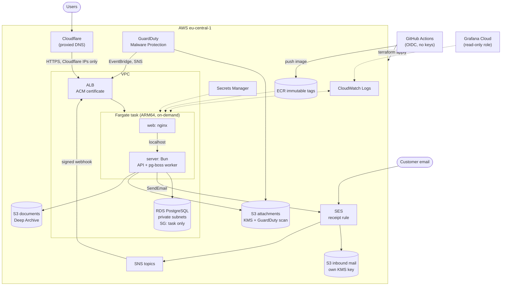
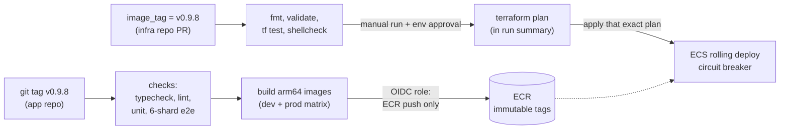

# Sorted: Case Study

**An AI-assisted support-ticket platform, built end to end and run on AWS with Terraform.**

| | |
|---|---|
| **Role** | Sole developer: application, infrastructure, CI/CD and operations |
| **Timeline** | Sept 17 to Oct 31, 2026 (about six weeks, 413 commits in the app repo, 69 in the infra repo) |
| **Cloud** | AWS, `eu-central-1`: ECS Fargate, RDS PostgreSQL, ALB, SES, SNS, S3, KMS, GuardDuty, ECR, Secrets Manager, EventBridge, CloudWatch, IAM/OIDC |
| **IaC / CI/CD** | Terraform (AWS, Cloudflare and random providers), GitHub Actions, Docker multi-stage builds, GitHub OIDC |
| **App** | TypeScript, Bun, Express 5, React 19, PostgreSQL with row-level security, pg-boss, Vercel AI SDK |
| **Repos** | `sorted-app` (application, Dockerfile, release workflow) and `sorted-infra` (Terraform, deploy workflow) |

> **Scope note.** Sorted is a training project that I treated like a production system. This case study describes the **production configuration** that the launch switches on (Multi-AZ database, a NAT gateway per zone, on-demand Fargate under a Savings Plan). It is defined in Terraform and reviewed, and public launch is days away. Cost figures are my own estimates from the docs in the repo, not billing data, and failover has been designed and not yet drilled (see section 8).

---

## 1. The problem and the product

Anyone who talks to customers by email ends up with a shared inbox that nobody can search, assign or measure. Sorted turns that inbox into a ticket system:

- Each customer team gets a Sorted address (`support@<team>.sorted.onl`) or forwards its own address in.
- An incoming email becomes a ticket. AI classifies it (category, priority), summarizes it, and, for non-transactional questions, answers from the team's knowledge base.
- **Refund and payment tickets never go to the AI.** They always go to a human agent.
- Humans work a queue: assign, reply, merge, use reply templates, see the audit log.

It is multi-tenant SaaS with self sign-up, Stripe billing, three team roles plus platform roles, 22 UI languages, and a super-admin console (subscribers, custom plans, surveys, translations, danger-flag investigation).

## 2. Goals and constraints

1. **Safe by construction.** Ticket content is personal data. Tenant isolation, encryption and "the AI cannot do harm" had to be enforced by code and infrastructure, not by convention.
2. **Reproducible infrastructure.** Everything in AWS is in Terraform. Dev and prod come from one module, so they cannot drift.
3. **Cheap to run before it has revenue.** One developer, no customers yet. The design had to scale up with a few flag flips instead of a rebuild.
4. **Boring, auditable delivery.** Releases are immutable, rollbacks are a one-line change, and no long-lived AWS keys exist anywhere.
5. **Operable by one person.** Logs, alerts and a runbook short enough to read at 03:00.

---

## 3. Architecture at a glance



**Request path.** Browser → Cloudflare → ALB (HTTPS, ACM) → nginx in the task → Bun server on `localhost:3000` → RDS.

**Mail path.** Customer email → SES receipt rule → S3 (KMS-encrypted) and SNS → signed webhook on the ALB → ticket saved → `pg-boss` job → AI classification → agent queue or auto-reply → SES out → delivery events back through SNS.

---

## 4. Infrastructure on AWS (the main story)

The module (`modules/sorted`, about 3,000 lines of HCL across 19 files) builds one complete environment. `envs/dev` and `envs/prod` are separate Terraform roots with their own state key, provider lock file and VPC. They call the module and set its feature flags (Spot, NAT, Multi-AZ, schedule, domain, mail and so on). The differences between environments are settings, not copies of code.

### 4.1 Compute: ECS Fargate, no servers to patch

- **One task, two containers.** nginx (`web`) serves the built React client and proxies `/api` to the Bun server over `localhost`. The server also runs the background worker, so there is no separate worker fleet at this stage. A `SERVER_ROLE` switch (`all`/`api`/`worker`) exists for splitting them later.
- **Graceful shutdown.** The server container has `stopTimeout = 30` so pg-boss and open streams drain. The `web` container depends on the server being `HEALTHY`.
- **Safe rollouts.** The service uses a rolling deployment (min 100 % / max 200 %) with the **deployment circuit breaker and automatic rollback**. A bad image that never turns healthy is rolled back by ECS on its own. A 180-second health-check grace period covers `prisma migrate deploy` plus start-up.
- **Expand/contract migrations.** Because two servers briefly overlap during a rolling deploy, every database migration must work with the previous release's code (add first, remove in a later release). This is written down as a rule, and dev deploys the same way so a violation shows up there first.
- **ECS Exec** is enabled for break-glass shells, with no SSH and no bastion.
- **Graviton (ARM64)** for about 20 % lower Fargate cost. The Dockerfile keeps architecture-independent stages (dependency install, Vite build, Prisma generate) on the build host's native platform and only the final stages target arm64, so an x86 CI runner does not emulate ARM for the heavy work.

### 4.2 Networking and the security perimeter

- **VPC** per environment (`10.20.0.0/16` prod, `10.21.0.0/16` dev), two AZs, public subnets for the ALB (and NAT) and private subnets for the task and database.
- **Security groups reference each other, not CIDRs.** The ALB can only talk to the task on port 80. The task only accepts traffic from the ALB's security group. RDS only accepts 5432 from the task's security group. There is no inbound path from the internet to the app or database except through the load balancer.
- **Only Cloudflare can reach the ALB** (`cloudflare_only`). The ALB's security group allows HTTPS solely from a managed prefix list of Cloudflare's IPv4 ranges. Port 80 is closed entirely (Cloudflare redirects). nginx then trusts `CF-Connecting-IP`, which only Cloudflare can set, so the app sees the real visitor address. This matters because sign-up, contact-form and sign-in rate limits are per address. Without it, every visitor would share one Cloudflare edge IP. A runbook note records the one failure mode to remember: if Cloudflare adds ranges, a visitor served from a new range gets no answer until the list is updated.
- **S3 gateway endpoint** (free) keeps S3 and ECR layer traffic off the NAT gateway.
- **Multi-AZ production.** `db_multi_az` gives RDS a synchronous standby in the second zone with automatic failover. `nat_gateway_per_az` adds a NAT gateway and a private route table per zone, so a task restarted in the surviving zone keeps its outbound access. After a zone outage ECS restarts the task in the other zone, a short interruption by design. Dev keeps single-AZ and no NAT on purpose, to cost almost nothing.

### 4.3 Data: RDS PostgreSQL

- Private subnets only, `storage_encrypted`, Performance Insights, deletion protection and 7-day backups in prod.
- **Database TLS as a staged rollout.** `db_tls` takes `off`, `verify` or `require`. `verify` sets `sslmode=verify-full` with the RDS CA bundle baked into the server image. `require` also sets `rds.force_ssl = 1` on the instance. The runbook says to apply them one at a time, with a `pg_stat_ssl` query to prove every connection is encrypted before enforcing, so a stale task cannot be locked out.
- **A real gotcha, documented.** Prisma's schema engine ignores libpq-style TLS parameters and silently connects unencrypted. The migration URL therefore gets Prisma's own parameters and the instance's single CA.
- Secrets (DB password, auth secret, API keys) are generated or injected by Terraform into **Secrets Manager** and passed to the task as secret references, never as plain values in the task definition.

### 4.4 Email: SES, SNS and S3 as an inbound pipeline

This is the part of the infrastructure that is specific to the product.

- **Terraform creates** the SES identity (Easy DKIM), a configuration set whose events go to SNS, a receipt rule that writes to S3 and notifies SNS, the DKIM and MX record list (for Cloudflare), and the IAM for the task.
- **A two-step apply is intentional.** SNS must confirm each subscription against the running app, and the app only confirms topics it was started with. So `ses_webhooks_subscribed` is a second apply after the new task is up.
- **Webhooks only trust SNS.** The app verifies SNS signatures against the environment's two topic ARNs.
- **The inbound bucket** has its own KMS key that only the receipt rule may encrypt with and only the task role may decrypt with. It has TLS-only bucket policy and 7-day expiry. If the app is down, SNS retries for the better part of an hour and then drops the notification, but the raw email is still in S3 under its SES message ID and can be replayed. This is in the runbook.
- **No mail credentials exist.** The task role signs SES and S3 calls itself.
- **One shared SES receipt rule set.** An account has a single active rule set per region, so prod creates and activates it and dev adds its rule to prod's. The apply order is documented.

### 4.5 Attachment safety: GuardDuty Malware Protection for S3

Customers email arbitrary files to a support system, which is a malware vector.

- Attachments go to a bucket with its **own KMS key**. **GuardDuty Malware Protection for S3** scans each object and tags it with a verdict.
- The **bucket policy denies reading any object that is not tagged `NO_THREATS_FOUND`**, for everyone except GuardDuty's role. So even a bug in the app cannot serve an unscanned file.
- The scan result also travels EventBridge → SNS → an app webhook so the UI updates. If that is delayed, the app reads the tag itself a couple of minutes later.
- The app enforces the same rule independently: only a `clean` attachment is ever served or sent, on any code path.

### 4.6 Documents and backups

A prod-only bucket holds the generated documentation PDF and the subscriber-CSV backups. It has a KMS key, versioning (non-current versions kept 365 days), TLS-only and a policy that denies other accounts. The app writes objects directly in **Glacier Deep Archive**, which is the cheapest class (a restore takes 12 to 48 hours, acceptable for backups). The runbook documents the `restore-object` step.

### 4.7 Delivery: immutable releases and keyless CI/CD



- **A release is a git tag.** The app's `release.yml` runs the full check suite first (a tag that fails checks is never released), then builds `server` and `web` images for each environment and pushes them as `:v0.9.8`. **ECR tags are immutable and there is no `:latest`.** A version always means the same bytes. The commit, version and build time are baked in as OCI labels and shown at `GET /api/version` and in the admin UI.
- **Deploying is a reviewed infrastructure change.** The environment's `image_tag` in `main.tf` names the release it runs. Rolling back means setting the previous tag, with the same code path as rolling forward.
- **No AWS access keys anywhere.** GitHub Actions uses **OIDC federation**. There are two separate roles per environment:
  - `…-github-ecr-push` is the app repo's role. It can push to that environment's two ECR repositories and nothing else.
  - `…-terraform-deploy` is the infra repo's role. It is an administrator, because `terraform apply` creates IAM, networks and databases, so what limits it is **trust**: only a job in this repo, in the GitHub environment of the same name, can assume it.
- **Trust is pinned to immutable repository IDs, not names.** The trust condition uses GitHub's immutable subject (`repo:<owner>@<id>/<repo>@<id>`) so a renamed or re-created repository cannot inherit the role.
- **Manual, gated deploy job.** Pushes and PRs only run checks. The `deploy` job runs only on `workflow_dispatch` from `main`, only after the validation jobs pass, uses a per-environment GitHub environment (prod can require reviewers), writes the **plan into the run summary**, and applies **that saved plan file**. Deploys are never cancelled by a newer push (an apply stopped halfway leaves a state lock and a half-changed environment), and there is a per-environment concurrency group.
- **Infrastructure CI.** Every PR runs `terraform fmt -check`, `init -lockfile=readonly` (fails if the provider lock is stale), `validate` per environment, and `shellcheck` on the deploy script. A suite of **22 offline `terraform test` runs with mocked providers** asserts the security properties without an AWS account: the DB TLS modes, the KMS and retention settings on the mail bucket, which addresses may reach SES, and who can assume the deploy role.
- **Remote state** in S3 with encryption and native lockfile locking (`use_lockfile`), one key per environment.

### 4.8 Observability and operations

- **Logs.** Containers log with `awslogs` to `/ecs/sorted-<env>` (30 days in prod, 7 in dev). The server logs structured JSON with `requestId`, `subscriberId`, `queue` and `ticketId`, so a user's `X-Request-Id` can be traced with one Logs Insights query.
- **Grafana Cloud reads CloudWatch in place.** Nothing is shipped or copied. Terraform creates a **read-only role** that Grafana's AWS account can assume only with the stack's **External ID** (the confused-deputy protection), limited to CloudWatch metrics and that environment's log group.
- **Alerts.** Synthetic uptime checks on the site and `/api/health` (which also checks the database), plus rules on ALB 5xx, latency and healthy hosts, ECS CPU and memory, RDS CPU, credits, memory, connections and free storage, and SES bounce and complaint rates. Alert rules live in Grafana, not Terraform. That is a known gap, listed below.
- **Spot visibility.** An EventBridge rule captures `stopCode = SpotInterruption` task events into a dedicated log group, so any restart is explainable.
- **Runbook.** `docs/runbook.md` is a symptom-first document: "first five minutes", an alert index mapping every alert to a section, rollback steps, and the failure modes I actually hit (stale secrets need a forced ECS rollout because a running task keeps the value it started with).
- **App-side:** Sentry for exceptions with all data-collection categories off, because ticket content is PII.

### 4.9 Cost engineering

The goal was to shrink the fixed cost of an unlaunched product without making go-live a rewrite. These are the decisions and their trade-offs.

| Lever | Where | Effect | Trade-off accepted |
|---|---|---|---|
| **Fargate Spot** | dev only | Task cost drops by roughly two thirds | A reclaim means one to three minutes of downtime (2-minute SIGTERM warning, graceful drain). Fine for dev. Prod runs on-demand Fargate |
| **Compute Savings Plan** | prod | 1 year, no upfront, about 20 % off on-demand Fargate (about $16 a month against about $20) | Bought after leaving Spot, since it does not discount Spot. The hourly commitment is sized below the task's steady cost |
| **No NAT gateway in dev** | `private_networking = false` | Saves about $38 a month. The task runs in public subnets with a public IP | Security group still admits only the ALB, and RDS stays private |
| **Off-hours schedule in dev** | `schedule.tf` | EventBridge Scheduler stops the service at 20:00 and RDS at 20:05, and starts RDS at 09:50 and the service at 10:00, weekdays, `Europe/Sarajevo` | No Lambda involved: Scheduler calls the ECS and RDS APIs directly. Weekends stay off, which also stays under RDS's 7-day auto-restart |
| **ARM64 / Graviton** | both | About 20 % cheaper compute | Needed an ARM image pipeline and a coordinated image/arch cutover (old tags are immutable amd64) |
| **Container Insights off in dev** | | About $5 a month | Basic metrics remain |
| **S3 gateway endpoint** | both | Free path for S3 and ECR layers | None |
| **Deep Archive for backups** | prod | Cheapest storage | Restores take hours |

My estimates, from the architecture doc: dev dropped from about **$105 to about $40 a month**, and prod with Multi-AZ and two NAT gateways is about **$150 a month**, a little less with the Savings Plan and an RDS reserved instance (roughly 30 % off). The ALB, NAT gateways and RDS are the fixed costs. The architecture doc also records the order of the production cutover, since leaving Spot replaces the ECS service and is done in a quiet moment.

---

## 5. Security model (infrastructure and application together)

| Layer | Control |
|---|---|
| Edge | Cloudflare proxy; ALB security group admits only Cloudflare ranges; HTTPS only; ACM certificate |
| Network | Private subnets for data; SG-to-SG rules; no SSH; ECS Exec only |
| Identity | OIDC for CI, no stored keys; separate push and deploy roles; trust pinned to repo IDs; External ID on the Grafana role; task role scoped per resource, with an explicit deny on deleting the mail domain identity |
| Data at rest | RDS storage encryption; separate KMS keys (rotation on) for inbound mail, attachments and documents; versioned documents |
| Data in transit | TLS-only bucket policies; staged `verify-full` DB TLS with `force_ssl` |
| Secrets | Secrets Manager injection; generated passwords; documented rotation caveat (force a new deployment) |
| Content safety | GuardDuty malware scan plus tag-based deny on read |
| Tenant isolation | PostgreSQL **row-level security** on every team table (`ENABLE` + `FORCE`), with a check that fails the build if a new table is neither tenant-scoped nor explicitly global |
| App auth | better-auth with database sessions, cookie cache off so revocation is immediate; roles enforced on the server; soft-deleted users behave as gone; sign-in errors never reveal whether an account exists |
| AI guardrails | The model returns structured data only; **application code decides** whether to auto-send; transactional (refund/payment) tickets are never auto-sent |

I'm not claiming a formal audit. The repo has a read-only `security-reviewer` agent definition, and I used review passes while building. Known gaps are listed in section 8.

---

## 6. The application

The infrastructure exists to run an application with some real design constraints.

### 6.1 Stack

TypeScript end to end. **Bun** workspaces with three packages: `client` (React 19, Vite 8, Tailwind 4, shadcn/ui, TanStack Query/Table, React Hook Form + Zod 4), `server` (Express 5, Prisma 7 with the pg driver adapter, better-auth, pg-boss, Vercel AI SDK), and `packages/contract`, a TypeScript-source package of types and rules shared by both sides (roles, statuses, reply document format, response types). The server checks its answers with `satisfies Sent<…>`, so changing a field on one side fails `bun run typecheck` on the other.

### 6.2 The inbound pipeline and its three structural rules

```
SES → S3 + SNS → webhook: verify signature → spam/SPF/DKIM → known sender?
    → save message (new ticket or thread) → enqueue → return 200
pg-boss worker: merge check → classify → summarize
    → transactional or auto-send off? → agent queue
    → knowledge-base answer? → generate → outgoing check → send
    → no answer → holding reply → agent queue
```

1. **The webhook never calls the AI.** It persists the message and returns 200. AI latency or failure cannot lose a customer's email.
2. **Guardrails are code, not prompt text.** The AI returns category, priority, confidence and a draft. Application code decides whether anything is sent.
3. **Every AI failure ends with the ticket `open` for a human.** The list hides `new`/`processing` tickets, so every path that does not resolve a ticket must hand it over. An auto-resolve error opens it at once (one extra try a minute later only for provider rate limits), a queue that refuses a job opens it, classification's last failed retry opens it, and an every-5-minute sweep opens anything older than 15 minutes that a crash left behind. Each move is conditional on the ticket still being `new`/`processing`, so an agent's action always wins.

### 6.3 Multi-tenancy

Every team table carries `subscriberId` and a Postgres RLS policy. The tenant context is written into `app.subscriber_id` on every connection checkout from the pool, so a forgotten `where` clause in application code returns zero rows instead of leaking another customer's tickets. Platform-level access uses an explicit bypass context, and scripts and migrations that need it say so.

### 6.4 Server architecture

Each of 61 modules has three layers: **routes** parse and answer, **services** decide and throw typed `AppError`s, **repositories** are the only code that touches Prisma. This is enforced by an `architecture.test.ts` that fails on layer violations, and a counter for the older untyped answers that is only allowed to go down.

### 6.5 Product features worth naming

Ticket queue with piles, live counts, bulk edit (with Undo), saved tickets, merge, audit logbook, reply templates; AI classify/summarize/refine/auto-resolve and an in-app assistant (Sorty); self sign-up with Google; Stripe Managed Payments with embedded checkout; plan entitlements decided in one function (`entitlementsOf`); super-admin custom plans, subscriber surveys with their own results dashboard, a content sweep that flags accounts for illegal activity, a translation dashboard over 22 languages, a generated manual with PDF and backups, and a public landing page whose claims are tested against the product.

### 6.6 Testing

| Layer | Tooling | Scale |
|---|---|---|
| Server | Vitest, services with faked repositories, layer-boundary tests | about 227 test files |
| Client | Vitest 5 + React Testing Library + jsdom | about 298 test files |
| End to end | Playwright against its own client, server and database | about 281 spec files |
| Infrastructure | `terraform test` with mocked providers | 22 runs |
| Docker/nginx | Vitest tests for the nginx config, security headers, entrypoint and RDS CA splitting | 5 files |

The e2e suite is split into **6 shards**, each with its own `postgres:18` service and a non-superuser database role, after a step that migrates, seeds and **checks RLS is enforced**, because a superuser role would bypass it and hide the exact bug the check exists to catch. Each shard uploads a blob report that a final job merges into one HTML report. Jobs run on self-hosted runners selected through repository variables, falling back to GitHub's runners.

---

## 7. Problems I hit and how they were resolved

These are the useful parts of the six weeks.

| Problem | Cause | Resolution |
|---|---|---|
| Every visitor looked like one IP; per-address rate limits were shared | Behind a proxy, the app saw Cloudflare's edge address | Locked the ALB to Cloudflare's ranges, then trusted `CF-Connecting-IP` only because nothing else can reach the ALB. Added tests for the nginx real-IP config |
| SES webhooks could not be subscribed in the first apply | SNS needs the running app to confirm, and the app confirms only known topics | Split into a second apply behind a flag, and documented the order |
| Dev's schedule failed with an API validation error | A `for_each` map unified the objects and turned `DesiredCount` into the string `"0"` | Pass the inputs as pre-encoded JSON strings; fixed in the commit "Keep the schedules' DesiredCount a number" |
| Prisma connected without TLS even with `sslmode=verify-full` | `prisma migrate deploy` ignores libpq parameters | Separate `MIGRATE_DATABASE_URL` with Prisma's own parameters and a pinned CA |
| A rotated secret did not take effect | A running ECS task keeps the env values it started with, and the task definition did not change | Documented as a rule: after changing a secret's value, force a new deployment. The same secret must change in the GitHub environment, or the next CI deploy restores the old one |
| ARM64 cutover | Old tags are immutable amd64 | Switched `cpu_architecture` and `image_tag` in the same apply; the release workflow builds arm64 by default |
| GitHub OIDC trust was name-based | A deleted and re-created repo name could inherit the role | Moved the trust condition to immutable owner and repo IDs |
| A stuck ticket after a crash | A job lost with the process left a ticket in `processing` forever | Added the `release-stuck-tickets` sweep as part of the "every AI failure ends open" rule |
| One account, one active SES rule set | SES allows a single active receipt rule set per region | Dev adds its rule to prod's set, with a documented apply order |

---

## 8. Honest limitations and what I would do next

- **One task, with zone failover rather than redundancy.** The database fails over across zones, but the single app task is restarted by ECS in the other zone, which is a short interruption. The design allows several tasks, since chat events cross over Postgres `LISTEN/NOTIFY` and the job queue is shared. I have not yet exercised it under real load or a real failover.
- **No autoscaling yet.** Next: run two or more tasks, add a target-tracking policy, and load test to find the real limit.
- **Alert rules and dashboards live in Grafana, not code.** Only the IAM role is in Terraform. I would move rules and contact points into the Grafana Terraform provider.
- **No WAF rules of my own.** The edge relies on Cloudflare's protection and the ALB restriction. I would add rate-based rules and bot controls and test them against the SES and Stripe webhooks, since a challenge on those paths would silently break mail and billing.
- **Terraform state contains generated secrets in plain text** (a documented Terraform behavior). The bucket is private and encrypted, but I would move the generated secrets to be created outside state, or rotate them on a schedule.
- **The deploy role is an administrator.** This is a deliberate trade-off, and the trust conditions are tight, but a permission boundary and a scoped policy generated from a plan would be a better end state.
- **Backup restore is documented but not drilled.** I would schedule a restore test for both the RDS snapshot and the Deep Archive path.
- **Deploys are not blue/green.** Rolling with a circuit breaker is good enough for one task, but CodeDeploy-style traffic shifting would shorten the exposure window for a bad release.
- **Cloudflare IP ranges are copied by hand.** A scheduled check that diffs them against Cloudflare's published list would remove the manual step.

---

## 9. What this project demonstrates

- Designing a **complete AWS environment from scratch** and expressing it as a single Terraform module reused for two environments, with offline tests on the security properties.
- **Keyless CI/CD** with OIDC, least-privilege roles, immutable artifacts, a plan-then-apply gate, and rollback that is just a version change.
- **Defense in depth** around untrusted input (email and attachments): signed webhooks, KMS, malware scanning with tag-based access control, TLS everywhere, and tenant isolation in the database.
- **Cost-aware design** that keeps the production topology one flag away, instead of building a throwaway.
- **Operational thinking**: graceful shutdown, health checks and grace periods, circuit-breaker rollback, expand/contract migrations, structured logs, alerts tied to a runbook, and every sharp edge written down where the next person will look.
- A **non-trivial application** with multi-tenancy, background jobs, AI used under code-enforced guardrails, billing, i18n, and a test pyramid (about 530 unit test files, about 280 e2e specs) that gates every release.

---

### Appendix: where to look

| Topic | File |
|---|---|
| Environment diagrams, cost table, Spot behavior | `sorted-infra/architecture.md` |
| Setup, releases, HTTPS, SES, DB TLS, Grafana | `sorted-infra/README.md` |
| Module resources | `sorted-infra/modules/sorted/*.tf` |
| Offline infra tests | `sorted-infra/modules/sorted/tests/*.tftest.hcl` |
| Infra CI and deploy job | `sorted-infra/.github/workflows/ci.yml` |
| Release workflow and Dockerfile | `sorted-app/.github/workflows/release.yml`, `sorted-app/Dockerfile` |
| Incident runbook | `sorted-app/docs/runbook.md` |
| Monitoring setup | `sorted-app/grafana-cloud-setup.md` |
| Feature and API reference | `sorted-app/docs/features.md`, `sorted-app/docs/api-reference.md` |
